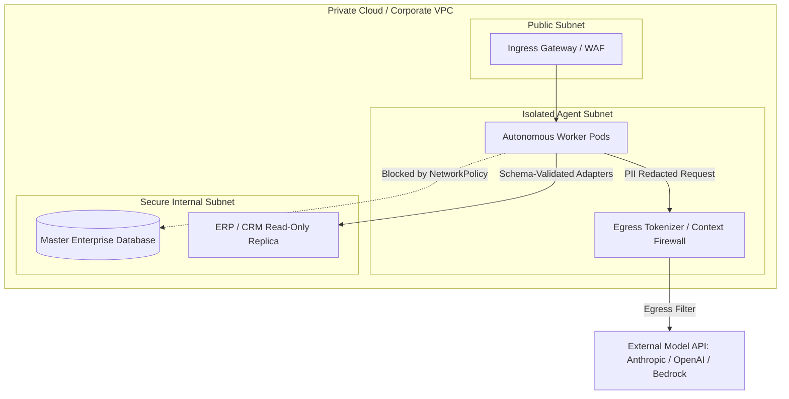

import { Aside, Tabs, TabItem } from '@astrojs/starlight/components';

<Aside type="caution">
Autonomous agent workers and LLM pipelines must never run with unconstrained network access or direct credentials to production databases. Running inside an isolated Virtual Private Cloud (VPC) enforces strict egress controls, PII scrubbing, and reviewable adapter boundaries.
</Aside>

## Threat Model & Security Posture

Autonomous agentic systems pose distinct security risks:
- **Prompt Injection & SSRF**: Abusive inputs tricking models into triggering unauthorized internal network calls.
- **Data Exfiltration**: Uncontrolled egress enabling outbound transmission of enterprise data or API keys.
- **Destructive Database Mutations**: Agent actions executing unintended `DROP`, `UPDATE`, or bulk deletions without approval gates.

---

## Isolated VPC Topology




## Network Isolation Rules

1. **Default Deny Egress**: Restrict outbound pod egress using Kubernetes NetworkPolicies. The only allowed outbound connections are to approved model provider endpoints and package registries over port 443.
2. **Read-Only Database Replicas**: Agents query read-only database replicas via standardized adapter contracts. High-risk write actions require human-in-the-loop (HITL) approval tokens.
3. **Egress Firewall & PII Redaction**: All model prompt payloads traverse a contextual egress proxy that tokenizes sensitive customer PII before packets leave the corporate perimeter.

### Sample Kubernetes Egress NetworkPolicy

```yaml
apiVersion: networking.k8s.io/v1
kind: NetworkPolicy
metadata:
  name: agent-runtime-egress-restriction
  namespace: agentic-grid
spec:
  podSelector:
    matchLabels:
      app.kubernetes.io/component: autonomous-worker
  policyTypes:
    - Egress
  egress:
    # Allow DNS resolution
    - to:
        - namespaceSelector:
            matchLabels:
              kubernetes.io/metadata.name: kube-system
      ports:
        - protocol: UDP
          port: 53
    # Allow connection only to internal contextual gateway
    - to:
        - podSelector:
            matchLabels:
              app.kubernetes.io/name: model-gateway
      ports:
        - protocol: TCP
          port: 8443
```


## Secrets Management & Credential Injection

- Never bake API keys into Docker images or pass them via plain environment variables.
- Inject secrets dynamically at pod runtime via HashiCorp Vault Agent sidecars or AWS Secrets Manager CSI drivers.
- Rotate provider credentials automatically every 30 days.

## Further Readings

- [VPC Security Best Practices](https://cloud.google.com/architecture/best-practices-vpc-design)
- [Kubernetes NetworkPolicy](https://kubernetes.io/docs/concepts/services-networking/network-policies/)
