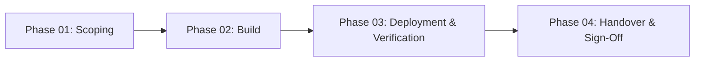

import { Aside, Steps } from '@astrojs/starlight/components';

<Aside type="note">
Jampuk Intelligence delivers high-velocity infrastructure, AI integrations, and modern web applications through structured, principal-led sprints. Engagements operate on a flat-rate price with fixed scope and async-first communication.
</Aside>

## Sprint Delivery Phases

Every project progresses through four disciplined phases:

---

<Steps>
1. **Phase 01: Technical Scoping & Architecture Lock (Days 1–3)**
   - **Requirement Extraction**: Detailed review of existing systems, API contracts, domain registries, and business constraints.
   - **Clean Architecture Mapping**: Isolate core business logic from external dependencies (databases, model providers, third-party APIs) using Ports & Adapters.
   - **Scope Lock & Fixed Quote**: Lock exact deliverable checklist, timeline, and all-inclusive flat fee. No scope creep, no hourly billing.

2. **Phase 02: Engineering Build & Private VPC Scaffolding (Days 4–10)**
   - **Isolated Scaffolding**: Development and testing conducted inside isolated private cloud environments or test VPCs.
   - **Adapter Construction**: Implement standardized interfaces for LLM providers, vector indices, relational stores, and messaging backplanes.
   - **Reproducible Manifests**: Package services into multi-stage Dockerfiles and Helm charts with complete CI verification.

3. **Phase 03: Deployment, Telemetry & Security Verification (Days 11–13)**
   - **GitOps Ingestion**: Push release manifests to target production cluster via automated reconciliation.
   - **Hardening Suite**: Apply CrowdSec intrusion detection, Nginx/Cloudflare security headers, TLS 1.3, and strict Kubernetes network policies.
   - **Verification Drills**: Execute load testing, fault-tolerance drills, and automated evaluation suites.

4. **Phase 04: Handover & Total Operational Ownership (Day 14)**
   - **Repository Handover**: Transfer primary repository ownership and revoke contractor access tokens.
   - **Runbooks & Video Walkthrough**: Hand over copy-pasteable incident runbooks, architecture specs, and recorded walkthroughs.
   - **Final Sign-Off**: Verification against the agreed deliverable checklist with zero ongoing fees.
</Steps>

---

## Operating Principles

- **Async-First Execution**: We prioritize written RFCs, Git pull requests, and recorded Loom demonstrations over endless Zoom meetings.
- **Principal-Led**: Work is engineered directly by seasoned systems architects, not passed down to junior agency staff.
- **Zero Retainers**: When the sprint concludes, your team has all the code and tools needed to operate independently.

## Further Readings

- [Agile Software Development](https://www.atlassian.com/agile/software-development)
- [Fixed-Price Engagement Models](https://www.mckinsey.com/capabilities/mckinsey-digital/our-insights/delivering-large-scale-it-projects-on-time-on-budget-and-on-value)
