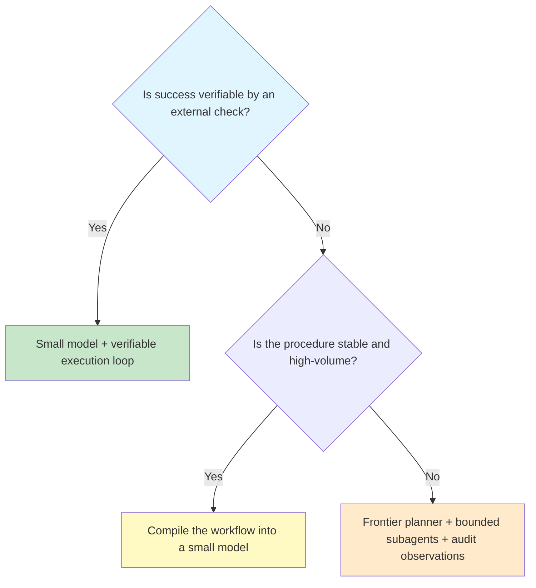

import { Aside } from '@astrojs/starlight/components';

<Aside type="note">
The default agent architecture — a frontier model running in a loop — is the easiest system to buy and the hardest one to justify per turn. Architecture should follow the properties of the task: whether success is checkable, whether the procedure is stable, and where ambiguity actually lives.
</Aside>

## Start with the task, not the model

The useful question is not "which model is best?" but "which architecture does this task justify?" A model is one component inside a loop that you can test, version, and improve.



In text form:

```text
Is success verifiable by an external check?
  yes -> small model + verifiable execution loop
  no  -> is the procedure stable and high-volume?
           yes -> compile the workflow into a small model
           no  -> frontier planner + bounded subagents + audit observations
```

## Architecture archetypes

| Architecture | Best fit | Feedback signal | Model class | Main failure mode |
| :--- | :--- | :--- | :--- | :--- |
| [Verifiable execution loop](/ai-integrations/verifiable-execution-loops/) | Coding, data transforms, migrations, any task with a deterministic check | Tests, schema validation, linters, read-only evaluators | Small active-parameter model, roughly 3B–8B | Stacking edits on a broken state; refining working code without a failure |
| [Compiled workflow](/ai-integrations/workflow-compilation/) | Stable, high-volume procedures with few exceptions | Golden traces and an offline evaluation suite | Small model with the procedure compiled into weights | Procedure drift after the source workflow changes |
| [Planner-led delegation](/ai-integrations/agent-delegation-routing/) | Ambiguous, cross-system work with mixed task types | Task outcomes plus [audit observations](/ai-integrations/agent-audit-observability/) | Frontier planner with narrow small executors | Coordination overhead and side effects the planner cannot see |

The archetypes are not mutually exclusive. A production system often uses a frontier planner, a verifiable loop for code changes, and a compiled workflow for the repetitive path inside the same engagement.

## Task inventory

Score each candidate task before choosing an architecture.

| Question | Why it matters | Evidence to collect |
| :--- | :--- | :--- |
| Can an external check decide success? | Verifiable outcomes make small models viable because the loop supplies the search signal. | Test suite, schema, linter, reconciliation query, business rule engine |
| Is the procedure stable and high-volume? | Stable repetition is a compilation candidate; novelty is not. | Procedure version history, exception rate, monthly volume |
| Where is the ambiguity concentrated? | Ambiguity belongs with the frontier planner, not every execution turn. | Examples of intent conflicts, missing fields, exception handling |
| Are side effects observable? | An agent cannot reason about a permission change or background job it cannot see. | Audit logs, event streams, change data capture, approval records |
| What does a failed attempt cost? | Retries and human review can erase a lower token price. | Attempts per success, review minutes, downstream rework |

## Six procurement and architecture rules

1. **Buy feedback before parameters.** If you can test the output, a smaller model is viable. If you cannot test it, a larger model only widens the margin before failure becomes visible — it does not make failure impossible.
2. **Compile the stable path.** Do not pay a frontier model to re-read the same procedure in every conversation. Compile it once and version the artifact like any other deployable.
3. **Reserve the frontier for ambiguity.** Planning, intent resolution, exception handling, and routing are worth the premium. Repeating a fixed sequence of tool calls is not.
4. **Refine only on failure.** Use non-coercive prompts, explicit verifier codes, and a skip path when the candidate already passes. A refinement loop without a failure gate generates regressions.
5. **Measure cost per successful task.** Token price is an input. Resolved tasks and constrained successes are the output. A cheaper model with a lower success rate can be the more expensive system.
6. **Make side effects visible.** Audit observations are part of the agent interface, not an afterthought. If the agent cannot see a permission change or background job, it cannot be trusted with dependent constraints.

## Failure modes at a glance

The full diagnosis and fix for each row lives in [Agent scaffold failure modes](/ai-integrations/agent-scaffold-failure-modes/).

| Failure mode | Typical symptom | First fix |
| :--- | :--- | :--- |
| JSON pipeline cliff | Format compliance collapses across multi-turn JSON schemas | Plain-text messaging, boundary validation, rigid decoding |
| Coercive over-correction | Working code is rewritten after a passing check | Refine only on an explicit verifier failure |
| Unnecessary paradigm overhead | Reflection or chain-of-thought runs on every task | Route by task with a Select-then-Solve classifier |
| Execution context bloat | The main agent carries every line of shell output | Delegate verbose operations to bounded subagents |
| Silent enterprise violation | A permission or background state change never appears in tool output | Expand the observation space to audit logs, event streams, and CDC |

## Further Readings

- [Verifiable execution loops](/ai-integrations/verifiable-execution-loops/) for the edit-check-repair contract.
- [Workflow compilation](/ai-integrations/workflow-compilation/) for moving stable procedures out of runtime context.
- [Agent delegation and routing](/ai-integrations/agent-delegation-routing/) for planner-led topologies and bounded subagents.
- [Agent audit and observability](/ai-integrations/agent-audit-observability/) for making side effects part of the observation space.
- [Cost per successful task](/ai-integrations/cost-per-successful-task/) for the economics behind the decision.
- [Agent scaffold failure modes](/ai-integrations/agent-scaffold-failure-modes/) for the reference table and pre-launch checklist.
- [LLM evaluation](/ai-integrations/llm-evaluation/) for offline and online quality measurement.
- [Model gateway](/ai-integrations/model-gateway/) for provider selection, fallback, and quotas.
- [Anthropic: Effective context engineering for AI agents](https://www.anthropic.com/research/effective-context-engineering-for-ai-agents)
- [SWE-bench](https://www.swebench.com/)
