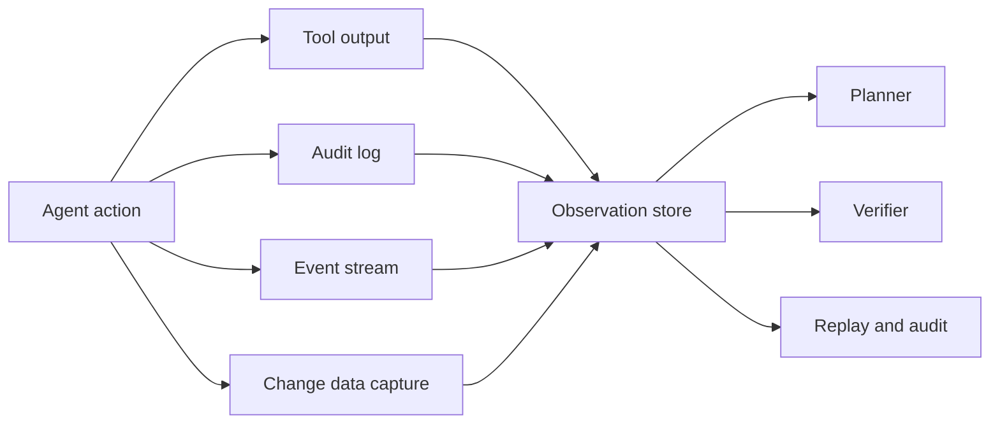

import { Aside } from '@astrojs/starlight/components';

<Aside type="caution">
An agent cannot reason about a side effect it cannot see. If a permission change, background job, or asynchronous state transition never appears in the observation space, the agent will plan against a stale model of the world — and may violate a constraint without any tool output signalling it.
</Aside>

## Observation space, not just logs

Traditional application logs are written for humans debugging a request. An agent needs observations it can act on: structured, correlated, and available while the task is still running.



The observation store is part of the agent interface. The planner reads it to decide what to do next; the verifier reads it to check what actually happened.

## What to capture

| Event class | Examples | Why the agent needs it |
| :--- | :--- | :--- |
| Tool invocation | Shell command, HTTP call, file edit, query | Reconstruct the action and its result |
| Approval | Human-in-the-loop token, review decision | Confirm that a high-risk action was authorised |
| Permission change | Role grant, repository access change, policy edit | Detect privilege changes that affect later steps |
| Background job | Queue message, scheduled task, async worker | Know when dependent work has actually completed |
| External state change | Webhook, partner system update, CDC event | Avoid planning against a stale record |
| Data mutation | Insert, update, delete, bulk operation | Verify the intended change and detect collateral damage |

The same missing case appears in [Agent scaffold failure modes](/ai-integrations/agent-scaffold-failure-modes/) as a **silent enterprise violation**: an asynchronous permission edit happens outside the tool output, so the agent continues as if nothing changed. The fix is to expand the observation space, not to write a stronger prompt.

## Trace schema

Use one correlation ID across the task, the planner, every subagent, and every side effect.

```json
{
  "trace_id": "trc_01j9z6k4",
  "task_id": "tsk_01j9z6k4",
  "timestamp": "2026-11-12T09:14:22.481Z",
  "actor": {
    "type": "agent",
    "id": "planner"
  },
  "action": "permission.update",
  "target": "repo:acme/billing",
  "result": "applied",
  "source": "audit_log",
  "approval_id": "apr_01j9z5x2",
  "attributes": {
    "from_role": "read",
    "to_role": "write"
  }
}
```

Minimum fields:

- `trace_id` and `task_id` for correlation.
- `actor` for the planner, subagent, human, or external system.
- `action` and `target` as a stable verb and resource name.
- `result` as a small, filterable enum.
- `source` to distinguish a tool result from an audit event.
- `approval_id` when the action required human authorisation.
- `timestamp` from a single clock source.

## Detection rules

Observability becomes useful when it changes behaviour. Wire observations into checks that the planner or verifier can consume.

| Rule | Trigger | Response |
| :--- | :--- | :--- |
| Unapproved privilege change | Permission update without a matching approval ID | Block dependent actions and escalate |
| Background job not settled | Dependent task proceeds before the job reaches a terminal state | Pause and re-check |
| Unexpected mutation | Row count or target differs from the declared change set | Escalate with the diff |
| Stale record | CDC event newer than the record used for planning | Refresh context and re-plan |
| Missing observation | A tool reports success but emits no audit event | Treat as unverified, not successful |

These are runtime checks, not dashboards. A dashboard that nobody reads does not prevent a violation.

## Read-only replay

Keep the observation stream replayable so failures can be investigated without re-running side effects.

- Store the inputs, observations, and decisions, not just the final answer.
- Make replay read-only by default.
- Redact or tokenise PII before indexing traces.
- Retain enough history to cover the longest dependent workflow and the compliance window.
- Give the verifier read access to the trace so it can check what happened, not only what the agent said happened.

## Relationship to the runtime boundary

The [Agent runtime VPC](/agentic-grid/agent-runtime-vpc/) page covers the security boundary: network isolation, egress control, least-privilege credentials, and human approval gates. This page covers the observation boundary. Both are required. A runtime can block an action and still leave the agent unable to see that the action was attempted or that a related state change occurred elsewhere.

## Further Readings

- [Agent runtime VPC](/agentic-grid/agent-runtime-vpc/) for network isolation and approval gates.
- [Agent architecture decision guide](/ai-integrations/agent-architecture-decision-guide/) for when audit observations are part of the architecture.
- [Agent delegation and routing](/ai-integrations/agent-delegation-routing/) for tracing subagent actions.
- [Verifiable execution loops](/ai-integrations/verifiable-execution-loops/) for runtime checks against the observation stream.
- [LLM evaluation](/ai-integrations/llm-evaluation/) for online telemetry and drift detection.
- [Agent scaffold failure modes](/ai-integrations/agent-scaffold-failure-modes/) for silent enterprise violations.
- [OpenTelemetry](https://opentelemetry.io/docs/) for traces, metrics, and logs.
- [NIST AI Risk Management Framework](https://www.nist.gov/itl/ai-risk-management-framework)
