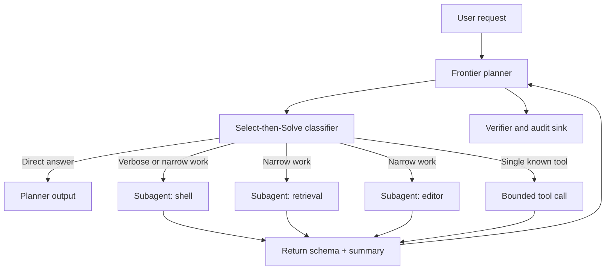

import { Aside } from '@astrojs/starlight/components';

<Aside type="caution">
Do not pay frontier prices for repetitive execution. Use the frontier model where ambiguity is concentrated — planning, intent resolution, exception handling, and routing — and delegate narrow execution to bounded subagents with explicit contracts.
</Aside>

## Two different routing layers

Model routing and task routing are often conflated. They solve different problems and belong in different parts of the system.

| Layer | Question | Typical owner | Failure if skipped |
| :--- | :--- | :--- | :--- |
| Model routing | Which provider or model handles this request? | [Model gateway](/ai-integrations/model-gateway/) | Hard-coded vendor lock-in, no fallback, uncontrolled spend |
| Task routing | Which actor should handle this task, with what context and budget? | Planner or classifier | Frontier model doing repetitive work, context bloat, runaway subagents |

A gateway can route to a cheap model for a simple request, but it cannot decide that a task should be decomposed into three subagents. That is task-level routing.

## Planner-led topology



The planner owns intent and sequencing. Subagents own execution. Only the planner needs the full conversation; subagents receive a slice.

## Select-then-Solve

A classifier decides how much machinery a task needs before the expensive model runs. It can be a small model, a rules table, or a hybrid.

```ts
export type Route =
  | { kind: 'direct' }
  | { kind: 'tool'; tool: string }
  | { kind: 'subagent'; role: 'shell' | 'retrieval' | 'editor' }
  | { kind: 'planner' };

export interface RouteDecision {
  route: Route;
  reason: string;
  confidence: number;
}
```

Routing rules should be explicit enough to test:

| Task shape | Route | Reason |
| :--- | :--- | :--- |
| Single known command with known arguments | Tool | No reasoning beyond parameter extraction |
| Short factual lookup in one source | Retrieval subagent | Bounded context, one return schema |
| Verbose shell or log processing | Shell subagent | Keeps raw output out of the planner context |
| Multi-step change across systems | Planner | Requires sequencing, exception handling, and verification |
| Ambiguous intent or missing constraints | Planner | Ambiguity belongs with the frontier model |

Log the decision, the reason, and the classifier confidence. Routing that cannot be explained cannot be tuned.

## Delegation contract

Every subagent invocation should be a contract, not a prompt fragment.

```ts
export interface Delegation {
  goal: string;
  allowedTools: string[];
  context: {
    include: string[];
    exclude: string[];
  };
  budget: {
    maxTokens: number;
    maxTurns: number;
    timeoutMs: number;
  };
  returnSchema: Record<string, unknown>;
}
```

The contract has four jobs:

- **Limit authority.** `allowedTools` is an allowlist. A shell subagent does not get database credentials; a retrieval subagent does not get write access.
- **Limit context.** `include` names the files, records, or messages the subagent needs. `exclude` keeps the rest of the session out.
- **Limit spend.** Token, turn, and time budgets are enforced by the runtime, not requested in prose.
- **Force a structured return.** `returnSchema` makes the result composable and keeps verbose output out of the planner.

A typical routing policy can be expressed declaratively:

```yaml
routes:
  - match: single-known-command
    route: tool
    model: small
  - match: verbose-shell-or-log-processing
    route: subagent
    role: shell
    budget:
      maxTokens: 4000
      maxTurns: 6
      timeoutMs: 120000
  - match: ambiguous-intent-or-cross-system-plan
    route: planner
    model: frontier
```

## Context isolation

The largest token savings usually come from what the planner never sees.

- Return a summary and an artifact reference from the subagent, not the full tool transcript.
- Keep raw logs, test output, and file contents in the trace store, retrievable by ID.
- Give the planner the decision-relevant fields: status, failure code, changed paths, and next action.
- Let the subagent re-read the source if it needs more detail; do not preload everything "just in case".

This pattern is especially effective for shell operations, where a single command can produce hundreds of thousands of tokens of output across a session.

## When not to de-aggregate

Delegation has coordination cost. It is not automatically an improvement.

- **Short tasks.** If a task fits in one tool call, a subagent adds latency and handoff overhead.
- **Shared mutable state.** Multiple subagents editing the same files or records need strong locking and ordering; often a single actor is safer.
- **Tight feedback loops.** If the planner must inspect every intermediate result, delegation hides the signal it needs.
- **Weak return schemas.** A subagent that returns free-form prose forces the planner to re-read everything, defeating the purpose.
- **No observability.** If subagent actions are not traced, delegation turns one opaque agent into several.

## Metrics

| Metric | What it reveals |
| :--- | :--- |
| Main-agent tokens per task | Whether context isolation is working |
| Delegated tokens and turns | Whether subagent budgets are realistic |
| Delegation rate by task class | Whether the classifier over- or under-routes |
| Subagent success and escalation rate | Where narrow executors need better contracts |
| End-to-end latency | The coordination cost of the topology |
| Cost per successful task | The combined effect of routing and retries; see [Cost per successful task](/ai-integrations/cost-per-successful-task/) |

## Further Readings

- [Agent architecture decision guide](/ai-integrations/agent-architecture-decision-guide/) for when planner-led delegation is appropriate.
- [Model gateway](/ai-integrations/model-gateway/) for provider routing, fallback, and quotas.
- [Cost per successful task](/ai-integrations/cost-per-successful-task/) for the economics of delegation.
- [Agent audit and observability](/ai-integrations/agent-audit-observability/) for tracing subagent actions and approvals.
- [Agent scaffold failure modes](/ai-integrations/agent-scaffold-failure-modes/) for context bloat and unnecessary overhead.
- [Prompt and context engineering](/ai-integrations/prompt-context-engineering/) for context budgeting and structured output.
- [Anthropic: Building effective agents](https://www.anthropic.com/research/building-effective-agents)
