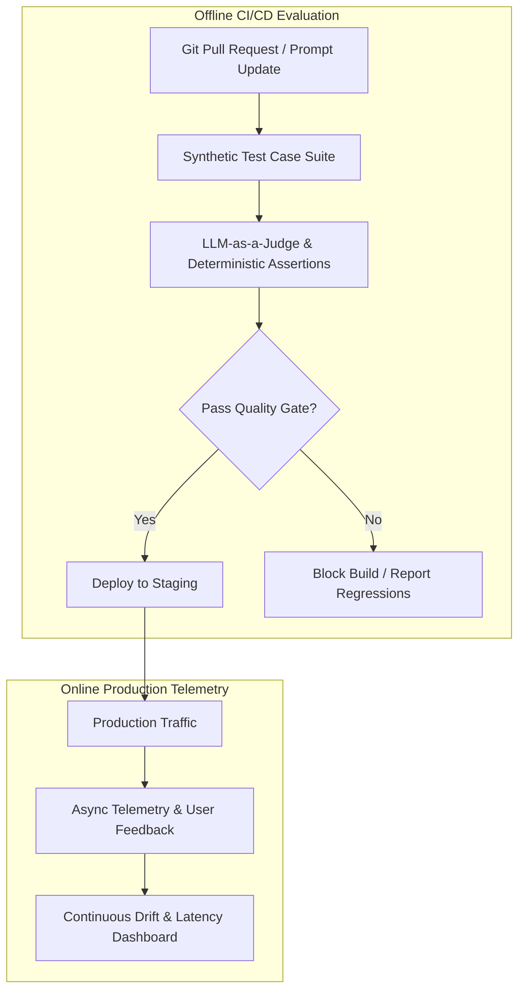

import { Aside, Tabs, TabItem } from '@astrojs/starlight/components';

<Aside type="note">
Deploying LLM systems to production requires automated, quantifiable evaluation suites. Without automated regression testing, prompt edits, model version bumps, or retrieval adjustments can introduce silent hallucinations and degrade output quality.
</Aside>

## Dual Evaluation Architecture



---

## 1. Offline Evaluation (CI/CD Quality Gates)

Run automated test suites against a curated golden benchmark dataset before merging changes:

### Key Metrics to Evaluate

1. **Faithfulness / Groundedness**: Are all claims in the generated response strictly grounded in the retrieved reference context?
2. **Answer Relevance**: Did the model directly address the user query without superfluous tangent information?
3. **Context Recall**: Did the retrieval pipeline capture all necessary reference facts required to form the answer?
4. **Negative Constraint Adherence**: Did the model respect safety directives (e.g. "Do not give financial advice")?

### Automated Test Pipeline Example (Python / Pytest)

```python
import pytest
from deepeval import assert_test
from deepeval.test_case import LLMTestCase
from deepeval.metrics import FaithfulnessMetric, AnswerRelevancyMetric

def test_rag_pipeline_faithfulness():
    user_query = "What is the DMARC enforcement policy?"
    retrieved_docs = ["DMARC policy must be set to p=reject after monitoring."]
    actual_output = "The enforcement policy for DMARC is p=reject."

    test_case = LLMTestCase(
        input=user_query,
        actual_output=actual_output,
        retrieval_context=retrieved_docs
    )

    faithfulness = FaithfulnessMetric(threshold=0.90)
    assert_test(test_case, [faithfulness])
```


## 2. LLM-as-a-Judge Pattern

When exact string matching is impossible, use a high-reasoning frontier model (e.g. Claude 3.7 Sonnet or GPT-4o) as an automated evaluator:

- Supply explicit evaluation rubrics with 1–5 scoring scales.
- Force the judge to output structured chain-of-thought justification before producing the score.
- Run deterministic string checks (regex, JSON schema validation) *first* to avoid wasting API tokens on broken formatting.

---

## 3. Online Telemetry & Real-Time Auditing

- **Implicit Signals**: Measure user copy actions, document downloads, edit distances, and abandonment rates.
- **Explicit Signals**: Thumbs up/down feedback with optional bug classification tags.
- **Drift Detection**: Trigger Slack/PagerDuty alerts when average response length or toxicity scores deviate from baseline.

## Further Readings

- [LLM Evaluation Frameworks](https://github.com/evidentlyai/evidently)
- [MLOps Evaluation Patterns](https://mlflow.org/docs/latest/)
