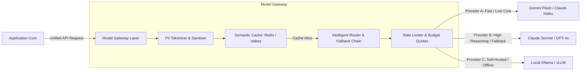
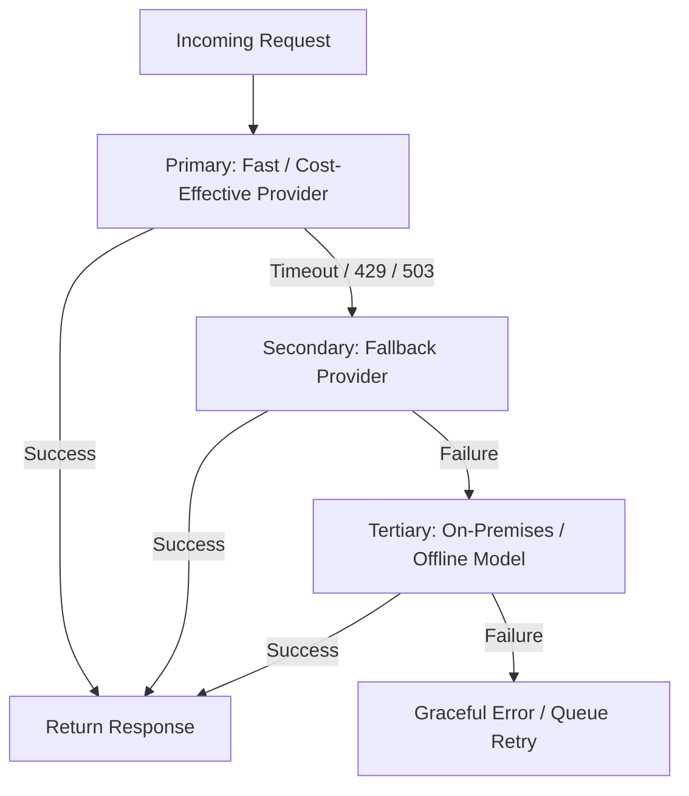

import { Aside, Tabs, TabItem } from '@astrojs/starlight/components';

<Aside type="caution">
Never embed vendor-specific SDKs or hard-coded API keys directly into your business logic. A model gateway abstracts model providers behind stable adapter ports, allowing seamless failover, cost optimization, and zero-trust security boundaries.
</Aside>

## Gateway Architecture




## 1. Provider-Agnostic Adapter Pattern (Clean Architecture)

Define a standardized interface that your core application uses:

```typescript
export interface ModelRequest {
  systemPrompt: string;
  userPrompt: string;
  temperature?: number;
  maxTokens?: number;
  jsonSchema?: object;
}

export interface ModelResponse {
  content: string;
  tokenUsage: {
    promptTokens: number;
    completionTokens: number;
    totalCostUSD: number;
  };
  latencyMs: number;
  provider: string;
}

export interface ModelGatewayPort {
  generate(request: ModelRequest): Promise<ModelResponse>;
}
```

Implement concrete adapters for Anthropic, Google Gemini, OpenAI, or local runtimes (vLLM). The application never knows or cares which vendor handles the request.

---

## 2. Fallback Chains & Circuit Breakers

Upstream AI providers experience frequent rate-limit bursts (HTTP 429) and outages (HTTP 503). Configure automated fallback chains:




## 3. Semantic Caching

Avoid paying repeatedly for identical or semantically similar queries:

- Generate embeddings for incoming prompts.
- Check a vector cache (e.g. Redis with RedisVL or pgvector) for existing responses with cosine similarity above 0.96.
- Return cached completions in under 15ms with zero provider API costs.

---

## 4. PII Redaction & Tokenization Boundary

Before requests leave the corporate VPC perimeter:

- **Regex & NER Scanning**: Detect social security numbers, credit card details, phone numbers, and names.
- **Token Replacement**: Substitute detected entities with synthetic tokens (e.g., `[CUSTOMER_ID_982]`).
- **De-tokenization**: When the model response returns, reverse the token replacement before handing data to the user.

## Further Readings

- [API Gateway Patterns](https://aws.amazon.com/api-gateway/)
- [Service Mesh Introduction](https://istio.io/latest/docs/concepts/what-is-istio/)
