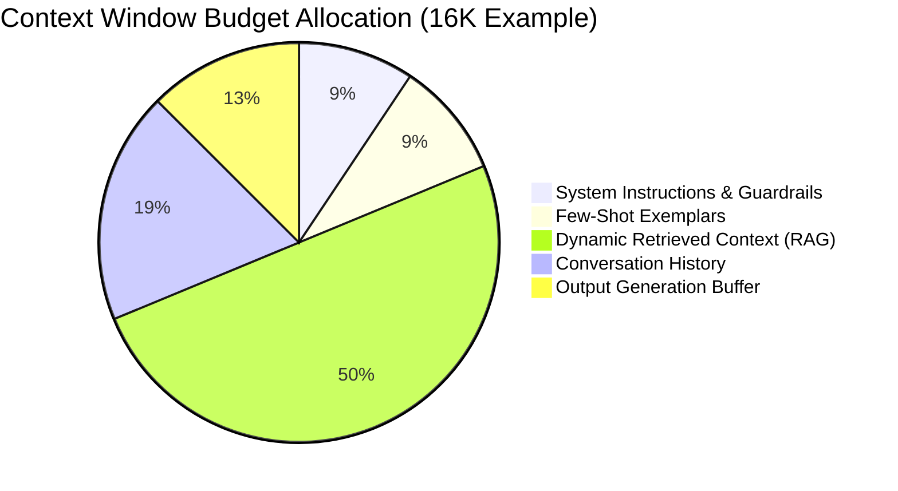

import { Aside, Tabs, TabItem } from '@astrojs/starlight/components';

<Aside type="tip">
Prompt and context engineering in enterprise systems is about deterministic schema contracts, context budgeting, and version-controlled templates—not trial-and-error prompt crafting.
</Aside>

## Context Window Budgeting

Model context windows are finite resources with asymmetric cost and latency curves. As context sizes expand, attention degradation ("lost in the middle") and latency increase significantly.



### Context Optimization Strategies

- **Dynamic History Truncation**: Maintain a sliding window of recent messages, replacing older dialogue turns with an ongoing semantic summary.
- **Context Pruning**: Strip unnecessary whitespace, HTML boilerplate, and non-essential JSON fields before feeding documents into the prompt.
- **Lost-in-the-Middle Mitigation**: Place the most critical reference data and negative constraints near the very start and very end of the prompt payload.

---

## Structured Output Enforcement (Zod / JSON Schema)

Never parse freeform markdown or unstructured prose when downstream microservices rely on the output. Mandate strict JSON schema conforming to typed schemas:

```typescript
import { z } from 'zod';

export const IngestionExtractionSchema = z.object({
  invoiceNumber: z.string().min(1),
  vendorName: z.string(),
  totalAmount: z.number().positive(),
  currency: z.string().length(3),
  lineItems: z.array(
    z.object({
      description: z.string(),
      quantity: z.number().int().positive(),
      unitPrice: z.number().positive(),
    })
  ),
  confidenceScore: z.number().min(0).max(1),
});

export type IngestionExtraction = z.infer<typeof IngestionExtractionSchema>;
```

Pass the JSON schema definition directly into the model's `response_format` (e.g. OpenAI Structured Outputs or Anthropic Tool Calling) to guarantee 100% syntactically valid JSON responses.

---

## Template Versioning & Testing

Treat prompts as production software artifacts:

1. **Version-Controlled Templates**: Store prompt templates in Git alongside code (e.g., `prompts/triage-v2.1.txt`), not in third-party SaaS databases.
2. **Template Interpolation**: Use typed template formatters to inject variables safely without string concatenation vulnerabilities.
3. **Automated Unit Testing**: Run prompt assertions against golden datasets in CI to verify that prompt template updates do not trigger behavioral regressions.

## Further Readings

- [Prompt Engineering Guide](https://prompthero.com/how-to-write-ai-prompts)
- [Context Window Design](https://www.anthropic.com/research/effective-context-engineering-for-ai-agents)
