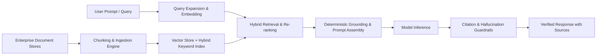
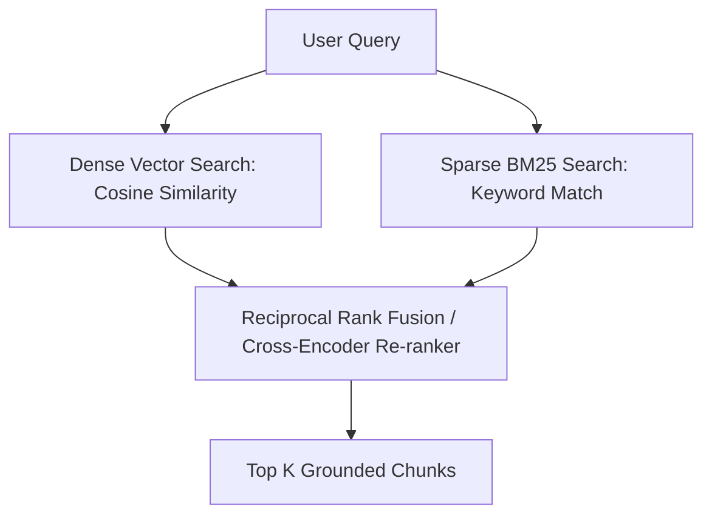

import { Aside, Steps, Tabs, TabItem } from '@astrojs/starlight/components';

<Aside type="note">
Retrieval-Augmented Generation (RAG) connects large language models to your proprietary enterprise data. In production systems, RAG must be engineered for deterministic factual reliability, auditability, and minimal latency—not guesswork.
</Aside>

## Production RAG Architecture




## 1. Chunking & Ingestion Strategies

Naive fixed-length character chunking breaks semantic meaning across paragraph and table boundaries. Production chunking requires structure-aware parsing:

- **Markdown & Header Chunking**: Split documents along logical section headers (`#`, `##`, `###`) to preserve topical context.
- **Table Preservation**: Keep tabular data intact using Markdown tables or JSON-LD representation rather than arbitrary character splits.
- **Overlap Budgeting**: Maintain a 10%–15% sliding window overlap (e.g. 512 token chunks with 64 token overlap) to prevent context loss across split boundaries.
- **Metadata Tagging**: Attach immutable document metadata (`source_uri`, `author`, `updated_at`, `access_tier`, `page_number`) to each chunk.

---

## 2. Hybrid Retrieval & Re-Ranking

Dense vector retrieval (cosine similarity over embeddings) excels at semantic concepts but often struggles with exact identifiers, part numbers, or legal citations. Production RAG combines dense and sparse retrieval:



1. **Dense Search**: Find semantically related passages using vector embeddings.
2. **Sparse BM25 Search**: Catch exact product codes, acronyms, and SKU identifiers.
3. **Cross-Encoder Re-Ranking**: Use a lightweight cross-encoder model to score query-chunk relevance before passing context to the LLM.

---

## 3. Deterministic Grounding & Prompt Assembly

Prevent hallucinations by structuring the prompt with strict negative constraints:

```text
You are an enterprise knowledge assistant. Answer the user question strictly using 
the provided reference context below.

Rules:
1. If the information required to answer the question is not present in the context, 
   state: "The provided reference documents do not contain this information."
2. Never extrapolate or introduce outside facts.
3. For every assertion, append the source citation tag [Doc ID].

Reference Context:
---
[Doc 104] Cloudflare Pages hosts static assets with automated edge caching...
[Doc 209] DMARC enforcement requires p=reject after monitoring phase...
---

User Query: {query}
```

---

## 4. Hallucination Indexing & Auditing

- **Source Attribution Verification**: Check that every claim in the generated text maps directly back to a retrieved chunk.
- **Automated Faithfulness Scoring**: In CI/CD, run evaluation pipelines (e.g., Ragas, TruLens) to assert context precision, context recall, and answer faithfulness score above 0.90.

## Further Readings

- [RAG Architecture Patterns](https://docs.anthropic.com/en/docs/build-with-claude/retrieval-augmented-generation)
- [Vector Database Comparison](https://qdrant.tech/articles/what-is-a-vector-database/)
