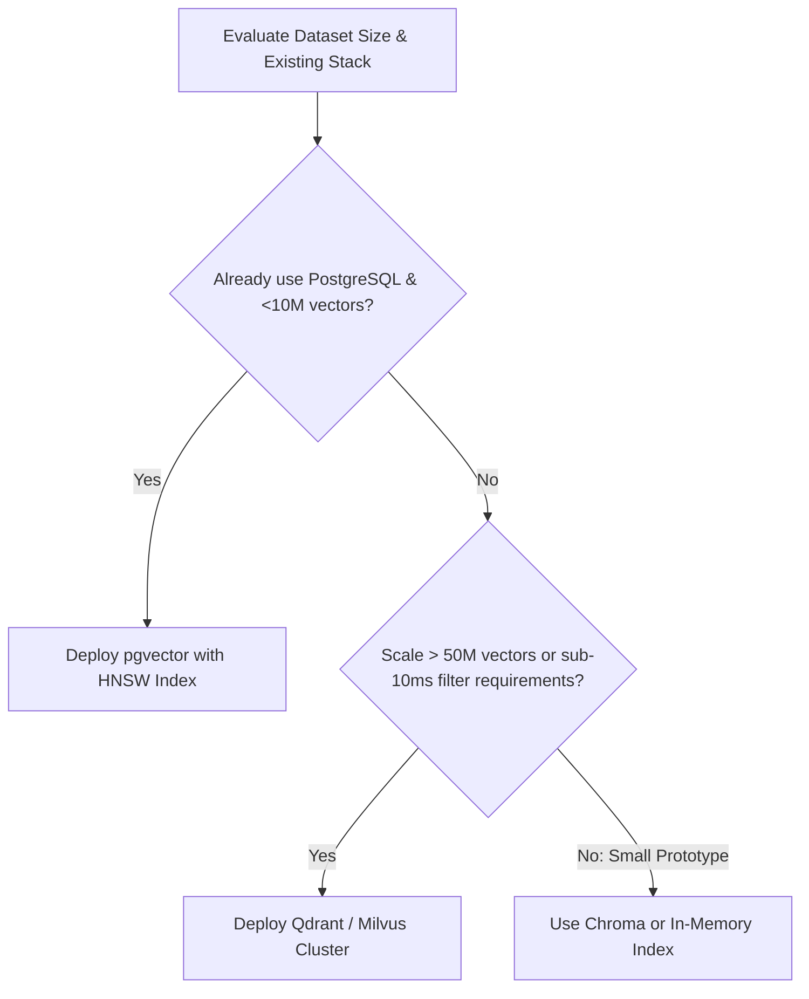

import { Aside, Tabs, TabItem } from '@astrojs/starlight/components';

<Aside type="tip">
Choosing a vector store depends on dataset scale, query concurrency, hosting requirements (private cloud / self-hosted vs managed SaaS), and whether your infrastructure already maintains a relational database like PostgreSQL.
</Aside>

## Architectural Comparison Matrix

| Vector Store | Deployment Model | Index Types | Max Typical Scale | Best Fit Use Case |
| :--- | :--- | :--- | :--- | :--- |
| **pgvector (PostgreSQL)** | Self-hosted / RDS / Cloud SQL | HNSW, IVFFlat | Up to ~10M vectors | Existing Postgres workloads; unified relational + vector queries; zero extra infrastructure. |
| **Qdrant** | Self-hosted (Rust binary) / Cloud | HNSW with payload filtering | 100M+ vectors | High-throughput search, rich metadata filtering, strict low-latency requirements. |
| **Milvus** | Distributed Kubernetes cluster | HNSW, IVF_SQ8, DiskANN | 1B+ vectors | Massive enterprise-scale datasets requiring horizontal sharding and cloud storage separation. |
| **Chroma** | Embedded / Lightweight Python/Docker | HNSW | Up to ~1M vectors | Prototyping, small internal tooling, and single-node desktop applications. |


## 1. pgvector: The Pragmatic Enterprise Choice

For the vast majority of enterprise applications (under 5 million vectors), adding the `vector` extension to an existing PostgreSQL database eliminates the need to run and monitor a separate database cluster:

```sql
-- Enable vector extension
CREATE EXTENSION IF NOT EXISTS vector;

-- Create documents table with embedding column (e.g. 1536 dims for OpenAI, 768 for small models)
CREATE TABLE enterprise_documents (
    id UUID PRIMARY KEY DEFAULT gen_random_uuid(),
    content TEXT NOT NULL,
    metadata JSONB,
    embedding vector(1536)
);

-- Build Hierarchical Navigable Small World (HNSW) index for fast cosine search
CREATE INDEX ON enterprise_documents 
USING hnsw (embedding vector_cosine_ops)
WITH (m = 16, ef_construction = 64);
```

### Querying with Cosine Distance

```sql
SELECT id, content, 1 - (embedding <=> $1) AS cosine_similarity
FROM enterprise_documents
WHERE metadata->>'department' = 'engineering'
ORDER BY embedding <=> $1
LIMIT 5;
```


## 2. Dedicated Vector Search Engines (Qdrant)

When workloads require complex nested filtering across millions of real-time payloads, specialized engines like Qdrant provide superior latency and resource efficiency:

- **Payload Indexing**: Index arbitrary JSON fields alongside vectors for millisecond filtering.
- **Quantization**: Scalar and product quantization reduce RAM footprints by up to 75% with minimal accuracy degradation.
- **Single Static Binary**: Extremely easy to deploy and monitor inside private Kubernetes clusters without JVM overhead.

---

## Indexing Decision Framework



### HNSW vs IVFFlat Indexing

- **HNSW (Hierarchical Navigable Small World)**: Higher build memory and longer build times, but delivers superior query speed and top-1 recall. Recommended for production search.
- **IVFFlat (Inverted File Flat)**: Faster to build and uses less RAM, but requires periodic re-indexing and can miss neighbors if clusters are skewed.

## Further Readings

- [Vector Database Benchmarks](https://qdrant.tech/benchmarks/)
- [PostgreSQL Vector Extension](https://github.com/pgvector/pgvector)
