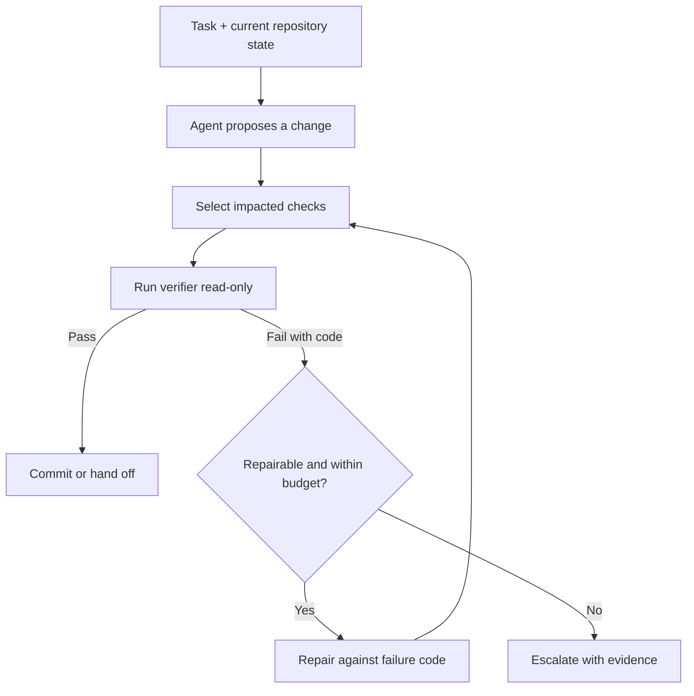

import { Aside, Steps } from '@astrojs/starlight/components';

<Aside type="caution">
The verifier must be independent of the model that produced the change. A model grading its own output is not a verifier; it is a second opinion with the same blind spots. Run checks read-only, with explicit failure codes, and stop the loop when the retry budget is exhausted.
</Aside>

## Loop anatomy

A verifiable loop turns an open-ended generation problem into a search problem with a checkable objective. The loop, not the parameter count, supplies most of the signal.



<Steps>
1. **Propose one change set.** Keep the diff focused so a failure can be attributed.
2. **Select the smallest useful check set.** Start with impacted tests, then add a smoke suite, and reserve the full suite for release gates.
3. **Run the verifier outside the agent's write scope.** Return a machine-readable status, failure code, and bounded output.
4. **Repair only on failure.** Feed the code and the failed checks back to the agent. If the candidate passes, skip refinement entirely.
5. **Stop on a budget or an unrepairable code.** Escalate with the diff, verifier output, and attempts already spent.
</Steps>

## Verifier contract

Define the verifier as a port so the loop is independent of any particular test runner.

```ts
export type ChangeSet = {
  repository: string;
  files: string[];
  diff: string;
};

export type VerifierResult =
  | {
      status: 'pass';
      checksRun: number;
      durationMs: number;
    }
  | {
      status: 'fail';
      code: string;
      failedChecks: string[];
      output: string;
    };

export interface Verifier {
  select(change: ChangeSet): Promise<string[]>;
  run(checks: string[]): Promise<VerifierResult>;
}
```

The failure `code` is the important part of the contract. It lets the loop make a routing decision without asking a model to interpret a wall of test output.

## Test selection

Running the entire suite after every edit is correct but often too slow. Select checks by change surface, and make the selection rule explicit.

| Change surface | First pass | Escalation |
| :--- | :--- | :--- |
| Single module with unit tests | Impacted unit tests | Module integration tests |
| Shared type or schema | Type check plus impacted tests | Contract tests |
| API or database migration | Contract tests and schema validation | Full integration suite |
| Dependency or build configuration | Lockfile check, type check, build | Full suite and smoke tests |
| Documentation only | Link and lint checks | None |

Record the selected checks in the trace. A loop that cannot explain why it ran a check cannot reproduce the result.

## Failure-gated repair

The repair prompt should be non-coercive and bounded. It exists to fix a specific failure, not to improve the candidate.

```text
You are repairing a failed candidate, not rewriting working code.

Failure code: {code}
Failed checks: {failedChecks}
Verifier output:
{output}

Rules:
1. Change only what is required to resolve the reported failure.
2. Do not touch files outside the submitted change set.
3. If the failure is environmental, missing a credential, or otherwise unrepairable,
   return ESCALATE with the evidence.
4. If the candidate already passes, return SKIP. Do not modify it.
```

Two guardrails matter more than prompt wording:

- **A skip path.** If the check already passes, the loop must be able to exit without touching the candidate. Without this, the refinement step becomes a regression generator.
- **A retry ceiling.** Cap attempts and total verifier time. A loop that retries indefinitely converts a cheap model into an expensive incident.

## Read-only evaluators

For higher-risk tasks, separate the actor from the evaluator:

- Run the evaluator in a process or container with read-only access to the artifact under test.
- Do not give the evaluator credentials that can mutate production state.
- Allow the evaluator to read tests, fixtures, logs, and schema definitions, but not to edit them.
- Return only the failure code, failed checks, and a truncated output window to the agent.
- Keep the full output in the trace for humans and replay.

This is the same separation used for CI quality gates, applied at runtime.

## Loop metrics

Track the loop as a system, not just the model:

| Metric | Why it matters |
| :--- | :--- |
| Verified pass rate | The share of tasks that end in a passing check, not a plausible answer |
| Attempts per success | Detects retry-prone tasks and weak verifier signals |
| Time to green | Captures the latency cost of running checks after every edit |
| Cost per successful task | Combines model, tool, retry, and review cost; see [Cost per successful task](/ai-integrations/cost-per-successful-task/) |
| Escalation rate and reasons | Shows which failures are unrepairable and where the verifier is too weak |
| Flake rate | Identifies checks that send the loop chasing a moving target |

Use [LLM evaluation](/ai-integrations/llm-evaluation/) for the offline suite that measures answer quality. The runtime loop is a different control: it decides whether a specific candidate is allowed to proceed.

## Common pitfalls

- **Coercive refinement.** Asking the model to "improve" a passing candidate creates changes without a failure signal. Gate every refinement on a verifier failure.
- **Verifier co-option.** If the agent can edit tests or fixtures, it can make the check pass without fixing the task. Keep test files outside the agent's write scope.
- **Cascading changes.** Stacking a second edit on a known-broken state hides the original failure. Repair from the last known-good state.
- **Full-suite tunnel vision.** Running everything after every token-level edit is safe but slow. Select checks by change surface and escalate deliberately.
- **Opaque output.** A pass/fail bit is not enough for repair. Return stable failure codes and a bounded excerpt.

## Further Readings

- [Agent architecture decision guide](/ai-integrations/agent-architecture-decision-guide/) for when a verifiable loop is the right architecture.
- [LLM evaluation](/ai-integrations/llm-evaluation/) for offline regression suites and quality gates.
- [Cost per successful task](/ai-integrations/cost-per-successful-task/) for attempts, retries, and review economics.
- [Agent scaffold failure modes](/ai-integrations/agent-scaffold-failure-modes/) for coercive refinement and related anti-patterns.
- [Agent audit and observability](/ai-integrations/agent-audit-observability/) for traces and replay of loop decisions.
- [SWE-bench](https://www.swebench.com/) for verified coding-task benchmarks.
- [Pytest](https://docs.pytest.org/) for the test runner used in many verifier implementations.
