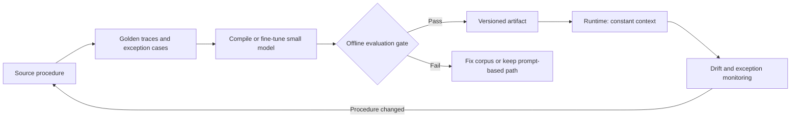

import { Aside, Steps } from '@astrojs/starlight/components';

<Aside type="note">
Compilation trades flexibility for repeatability. It is a good fit when the procedure is stable, the volume is high, and exceptions are rare enough to route to a frontier model. Compiling a workflow that changes every week just moves the maintenance cost into a harder-to-debug artifact.
</Aside>

## When compilation makes sense

Compiling means moving a deterministic procedure out of the runtime prompt and into a versioned artifact — typically a small model with the procedure embedded in its weights, or a compiled workflow with model-backed steps. The context required at runtime drops to a constant scale, and there is no translation layer re-reading the procedure on every call.



| Signal | Compile | Keep prompting |
| :--- | :--- | :--- |
| Procedure changes | Less than once a quarter | Weekly or ad hoc |
| Volume | High and predictable | Low or bursty |
| Exception rate | Low, with a clear escalation path | High or poorly understood |
| Input shape | Stable schema and bounded fields | Open-ended or rapidly evolving |
| Audit requirement | Deterministic trace per step | Exploratory reasoning must be visible |
| Cost pressure | Per-conversation frontier cost is material | Frontier cost is negligible |

If the procedure is stable but the volume is low, a deterministic workflow engine is often a better intermediate step than a compiled model. Compile when the per-call context and frontier cost are the dominant problem.

## Prompt, workflow engine, or compiled model

| Approach | Context at runtime | Change cost | Best fit |
| :--- | :--- | :--- | :--- |
| Prompt with few-shot examples | Large and repeated every call | Low | Early discovery, low volume, high variability |
| Deterministic workflow engine | Small, mostly parameters | Medium | Stable procedure with clear branches and tool calls |
| Compiled small model | Constant and small | High: requires recompilation and evaluation | Stable, high-volume procedure with few exceptions |
| Frontier planner | Large, but only for ambiguous steps | Low | Intent resolution, exception handling, routing |

Most production systems combine these. The planner handles ambiguity, the compiled artifact handles the repeatable path, and the verifier decides whether the result is acceptable.

## Artifact lifecycle

<Steps>
1. **Freeze the source procedure.** Write it as a versioned document with explicit inputs, branches, tool calls, failure codes, and escalation conditions.
2. **Build a golden corpus.** Capture successful traces plus the exceptions that must escalate. Include adversarial and boundary cases, not just happy paths.
3. **Compile.** Fine-tune or distill the small model, or generate the compiled workflow artifact. Record the base model, corpus hash, and compiler version.
4. **Evaluate before promotion.** Run the same offline suite used for prompt changes. Require a minimum pass rate and a maximum regression against the current production artifact.
5. **Version and deploy.** Treat the artifact like a container image: immutable version, changelog, rollout plan, and a known previous version.
6. **Monitor drift.** Track exception rate, escalation rate, and output distribution. A change in the source procedure or upstream schema invalidates the artifact.
</Steps>

## Illustrative artifact manifest

The exact schema is implementation-specific, but the fields should be present in some form:

```yaml
apiVersion: jampuk.ai/v1
kind: CompiledWorkflow
metadata:
  name: invoice-exception-triage
  version: 3.2.0
spec:
  sourceProcedure: procedures/invoice-exception-triage.md
  trainingCorpus: datasets/invoice-triage-golden.jsonl
  baseModel: small-model-8b
  evaluation:
    suite: evals/invoice-triage
    minPassRate: 0.95
    maxRegression: 0.02
  rollback:
    previousVersion: 3.1.0
```

The manifest is deliberately boring. The value is in the linkage: anyone can answer which procedure, which corpus, and which evaluation gate produced the running artifact.

## The economics

Compilation is a fixed cost paid up front against a per-conversation cost that disappears. A simple breakeven calculation:

```text
compile_cost + (small_cost_per_task * N) < frontier_cost_per_task * N

N > compile_cost / (frontier_cost_per_task - small_cost_per_task)
```

Use total cost per successful task on both sides, not token price. Include retries, verifier runs, human review, and the cost of recompiling when the procedure changes. If `N` is small or the procedure changes often, the breakeven point may never arrive.

## Risks and controls

| Risk | Control |
| :--- | :--- |
| Procedure drift | Version the source procedure and trigger recompilation when it changes |
| Overfitting the golden corpus | Hold out procedures and edge cases; evaluate on unseen traces |
| Hidden exceptions | Track escalation rate and route unhandled cases to the frontier planner |
| Lost auditability | Emit a step-level trace from the compiled workflow, not just the final answer |
| Irreversible rollout | Keep the previous artifact deployable and document rollback in the runbook |

## Further Readings

- [Agent architecture decision guide](/ai-integrations/agent-architecture-decision-guide/) for choosing compilation against the alternatives.
- [LLM evaluation](/ai-integrations/llm-evaluation/) for the offline suite that gates promotion.
- [Prompt and context engineering](/ai-integrations/prompt-context-engineering/) for the prompt-based path and context budgeting.
- [Cost per successful task](/ai-integrations/cost-per-successful-task/) for breakeven and telemetry.
- [Agent scaffold failure modes](/ai-integrations/agent-scaffold-failure-modes/) for over-correction and unnecessary overhead.
- [OpenAI: Fine-tuning guide](https://platform.openai.com/docs/guides/fine-tuning)
- [Hugging Face: Distillation](https://huggingface.co/docs/transformers/main_classes/trainer)
