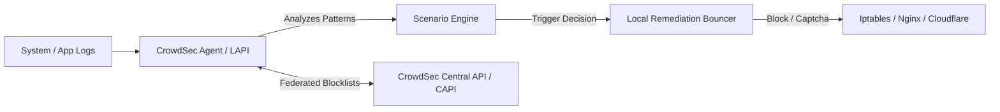

import { Aside, Steps, Tabs, TabItem } from '@astrojs/starlight/components';

<Aside type="tip">
CrowdSec is an open-source, lightweight behavioral intrusion prevention system (IPS). It parses service logs, detects offensive behavior using YAML scenarios, and applies local remediation while federating anonymized threat intelligence with a global defense network.
</Aside>

## Architecture Overview



- **CrowdSec Agent & Local API (LAPI)**: Parses logs, correlates events, matches scenarios, and issues remediation decisions.
- **Bouncers (Remediation Components)**: Standalone plugins that enforce decisions at the firewall (nftables/iptables), reverse proxy (Nginx/Traefik), or CDN level (Cloudflare).
- **Central API (CAPI)**: Synchronizes global community blocklists and pushes verified threat telemetry.

---

## Installation & Setup

<Steps>
1. **Add Repository and Install Agent**

   <Tabs>
   <TabItem label="Debian / Ubuntu">

   ```sh
   curl -s https://install.crowdsec.net | sudo bash
   sudo apt-get install crowdsec -y
   ```

   </TabItem>
   <TabItem label="RHEL / Rocky Linux">

   ```sh
   curl -s https://install.crowdsec.net | sudo bash
   sudo dnf install crowdsec -y
   ```

   </TabItem>
   </Tabs>

2. **Verify Acquired Log Sources**
   CrowdSec automatically discovers local services (Nginx, SSH, systemd):

   ```sh
   sudo cscli collections list
   sudo cscli metrics
   ```

3. **Install Firewall Remediation Bouncer**
   Install the kernel firewall bouncer (nftables or iptables):

   ```sh
   sudo apt-get install crowdsec-firewall-bouncer-iptables -y
   ```

   The bouncer registers with LAPI and creates an automated kernel drop rule for blocked IPs.
</Steps>

---

## Installing Essential Collections

Collections bundle parsers and behavioral attack scenarios:

```sh
# SSH brute force protection
sudo cscli collections install crowdsecurity/sshd

# Web application protection (Nginx, HTTP crawl, bad user agents, CVE scanners)
sudo cscli collections install crowdsecurity/nginx
sudo cscli collections install crowdsecurity/http-cve
sudo cscli collections install crowdsecurity/base-http-scenarios

# Reload crowdsec to activate
sudo systemctl reload crowdsec
```


## CLI Management & Inspection

Common administrative commands with `cscli`:

```sh
# View active ban decisions
sudo cscli decisions list

# Manually ban an abusive IP for 24 hours
sudo cscli decisions add --ip 198.51.100.42 --duration 24h --reason "targeted scanning"

# Remove a ban
sudo cscli decisions delete --ip 198.51.100.42

# Check alerts and telemetry
sudo cscli alerts list
```


## Integrating with Reverse Proxies (Nginx Bouncer)

To return custom 403 or challenge pages rather than dropping TCP connections at the firewall:

```sh
sudo apt-get install crowdsec-nginx-bouncer -y
```

This installs Lua-based integration directly into `/etc/nginx/conf.d/crowdsec.conf`, intercepting HTTP requests before they reach application upstreams.

## Further Readings

- [CrowdSec Documentation](https://docs.crowdsec.net/)
- [HTTPS Enforcement Guide](https://www.nginx.com/resources/wiki/rewrite/https/)
