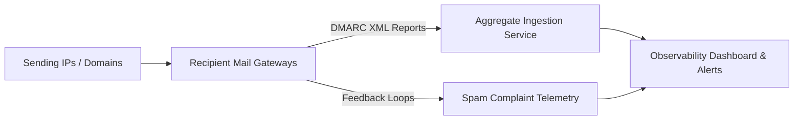

import { Aside, CardGrid, LinkCard } from '@astrojs/starlight/components';

<Aside type="note">
Email deliverability is not a one-off configuration. Continuous monitoring ensures domain reputation remains intact and rogue or unauthenticated sending sources are flagged before landing in spam folders.
</Aside>

## Core Telemetry Streams



### 1. DMARC Aggregate (RUA) Analysis

Recipient mail servers generate daily XML reports summarizing every message received claiming to originate from your domain:

- **Source IP & Country**: Identifies where the message originated.
- **Message Volume**: Count of messages processed in that window.
- **SPF Evaluation**: IP match result and alignment status.
- **DKIM Evaluation**: Cryptographic verification status and selector alignment.
- **Disposition**: Applied action (`none`, `quarantine`, `reject`).

Tools like Postmark DMARC, Valimail, or self-hosted Parsedmarc ingest these XML archives and produce actionable triage dashboards.

---

## 2. Mailbox Provider Telemetry

Direct feedback telemetry provided by major consumer inbox networks:

| Provider | Tool | Key Metrics Monitored |
| :--- | :--- | :--- |
| **Google** | Google Postmaster Tools (GPT) | Domain reputation, IP reputation, spam rate (keep under 0.1%), SPF/DKIM/DMARC success rates, delivery errors. |
| **Microsoft** | Smart Network Data Services (SNDS) | Sending IP status, complaint rates, spam trap hits, filter results. |
| **Yahoo / AOL** | Complaint Feedback Loop (CFL) | Automated ARF reports when users click "Mark as Spam". |

<Aside type="caution">
Google enforces strict thresholds: spam rates exceeding **0.3%** in Postmaster Tools trigger domain-wide filtering and bulk rejection.
</Aside>


## 3. Real-Time DNSBL & Blacklist Auditing

Monitor major Real-time Blackhole Lists (RBLs) and DNS Blocklists (DNSBLs):

- **Spamhaus (SBL, XBL, PBL, DBL)**: High severity. Immediate delivery failure across most enterprise and consumer mail servers.
- **Barracuda (BRBL)**: Widespread enterprise mail server usage.
- **SORBS & Invaluement**: Common secondary enterprise filters.

Automate daily reverse DNSBL queries across sending IPs:

```sh
# Reverse IP lookup against Spamhaus Zen
dig +short 25.100.51.198.zen.spamhaus.org
# Returns 127.0.0.x if listed, empty if clean
```


## Deliverability Health Checklist

- [ ] Daily spam rate remains strictly below **0.1%** (never sustained above 0.3%).
- [ ] DMARC aggregate compliance rate above 99.5% on active transactional streams.
- [ ] Automated alerts trigger on unexpected new sending IPs in aggregate reports.
- [ ] Feedback Loop (FBL) complaints immediately unsubscribe or suppress recipient addresses.
- [ ] DNSBL status tracked continuously via automated ping or monitoring agent.

## Further Readings

- [DMARC Aggregate Reporting](https://www.rfc-editor.org/rfc/rfc7489)
- [Email Authentication Overview](https://dmarcian.com/why-dmarc/)
