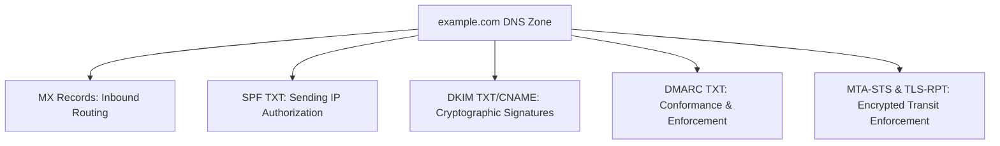

import { Aside, Tabs, TabItem } from '@astrojs/starlight/components';

<Aside type="note">
Clean email infrastructure requires deterministic DNS records covering mail routing, sender authorization, identity verification, TLS enforcement, and reverse pointer lookups.
</Aside>

## Master Record Architecture

An enterprise domain requires five core record types for robust email deliverability:




## 1. Mail Exchanger (MX) Records

Route inbound mail to destination mail servers, ordered by preference priority (lower number = higher priority):

```text
example.com.   3600  IN  MX  1   aspmx.l.google.com.
example.com.   3600  IN  MX  5   alt1.aspmx.l.google.com.
example.com.   3600  IN  MX  5   alt2.aspmx.l.google.com.
example.com.   3600  IN  MX  10  alt3.aspmx.l.google.com.
example.com.   3600  IN  MX  10  alt4.aspmx.l.google.com.
```


## 2. Reverse DNS (PTR) Records

Forward DNS maps `mail.example.com` $\rightarrow$ IP, while reverse DNS maps IP $\rightarrow$ `mail.example.com`.

- Recipient mail servers perform forward-confirmed reverse DNS (FCrDNS).
- The PTR record must resolve to a hostname whose `A` record points back to the exact same sending IP.
- PTR records are managed by the IP allocation provider (AWS Elastic IP, Hetzner, OVH, etc.), not the domain registrar.

```sh
# Query reverse DNS for an IP
dig -x 198.51.100.25 +short
```


## 3. Strict MTA-STS & TLS Reporting

**MTA Strict Transport Security (MTA-STS)** (RFC 8461) forces sending mail servers to deliver mail over valid TLS connections with trusted certificates, preventing man-in-the-middle (MITM) downgrade attacks.

<Tabs>
<TabItem label="_mta-sts TXT Record">

```text
Name:   _mta-sts.example.com.
Type:   TXT
Value:  v=STSv1; id=2026102801;
```

</TabItem>
<TabItem label="HTTPS Policy File">

Host policy at `https://mta-sts.example.com/.well-known/mta-sts.txt`:

```text
version: STSv1
mode: enforce
mx: aspmx.l.google.com
mx: alt1.aspmx.l.google.com
mx: alt2.aspmx.l.google.com
max_age: 604800
```

</TabItem>
<TabItem label="_smtp._tls TXT (TLS-RPT)">

Publish reporting address for TLS failures (RFC 8460):

```text
Name:   _smtp._tls.example.com.
Type:   TXT
Value:  v=TLSRPTv1; rua=mailto:tls-reports@example.com;
```

</TabItem>
</Tabs>


## 4. Brand Indicators for Message Identification (BIMI)

Display your organization's verified logo inside supporting email clients (Apple Mail, Gmail):

```text
Name:   default._bimi.example.com.
Type:   TXT
Value:  v=BIMI1; l=https://static.example.com/logo/bimi-icon.svg; a=https://static.example.com/certs/bimi-cmc.pem;
```

<Aside type="tip">
BIMI requires an enforced DMARC policy (`p=quarantine` or `p=reject`) across both the parent domain and subdomains before icons are displayed.
</Aside>


## DNS Validation Script

Run this verification block to audit your domain's records:

```sh
DOMAIN="example.com"
echo "=== MX ===" && dig +short MX $DOMAIN
echo "=== SPF ===" && dig +short TXT $DOMAIN | grep "v=spf1"
echo "=== DMARC ===" && dig +short TXT _dmarc.$DOMAIN
echo "=== MTA-STS ===" && dig +short TXT _mta-sts.$DOMAIN
```

## Further Readings

- [DNS Record Reference](https://en.wikipedia.org/wiki/List_of_DNS_record_types)
- [MTA-STS Implementation Guide](https://www.ncsc.gov.uk/collection/email-security-and-anti-spoofing/using-mta-sts-to-protect-the-privacy-of-your-emails)
