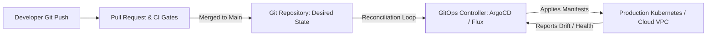

import { Aside, Steps, Tabs, TabItem } from '@astrojs/starlight/components';

<Aside type="note">
GitOps treats a Git repository as the single, auditable source of truth for all infrastructure, configuration, and application code. All production mutations must happen via pull requests and declarative reconciliation, never through direct manual SSH or ad-hoc kubectl commands.
</Aside>

## GitOps Architecture Models



### Push-Based vs Pull-Based Deployments

| Dimension | Push-Based (CI Runner $\rightarrow$ Cluster) | Pull-Based (Cluster Agent $\leftarrow$ Git) |
| :--- | :--- | :--- |
| **Execution** | CI runner executes `helm upgrade` or `kubectl apply`. | Controller inside cluster constantly pulls Git repo. |
| **Credentials** | CI runner requires broad cluster administrative credentials. | Zero inbound cluster credentials needed outside the VPC. |
| **Drift Detection** | Only catches drift during explicit deployment jobs. | Continuously repairs cluster drift back to Git state. |
| **Suitability** | Static sites (Cloudflare Pages), serverless, simple apps. | Enterprise Kubernetes, private VPCs, regulated workloads. |


## The Four GitOps Principles

1. **Declarative Descriptions**: The entire system is described declaratively (Helm, Kustomize, Terraform).
2. **Versioned Desired State**: The desired state is stored in version control with complete audit histories.
3. **Automated Pull & Apply**: Approved changes are automatically pulled and applied to target environments.
4. **Continuous Software Reconciliation**: Agents continuously observe runtime state and reconcile discrepancies.

---

## Deployment Workflow & Approval Gates

<Steps>
1. **Branching & Feature Development**
   Engineers develop changes on feature branches. Local testing is validated against reproducible container builds.

2. **Automated CI Validation**
   Automated workflows execute linting, type-checking, security vulnerability scanning, and unit tests on pull request creation.

3. **Peer Review & Cryptographic Sign-Off**
   Pull requests require at least one code review approval and signed Git commits before merging into `main`.

4. **GitOps Ingestion & Progressive Rollout**
   The GitOps agent detects the new commit SHA, verifies image signatures (Cosign), and executes a canary or rolling update on the target cluster.
</Steps>

---

## Verification & Rollback Strategy

Because state is declared in Git, a rollback is executed via standard Git commands:

```sh
# Instant rollback: Revert the merge commit and push
git revert HEAD -m 1
git push origin main
```
The GitOps agent immediately recognizes the reverted commit and redeploys the prior stable state.

## Further Readings

- [ArgoCD Documentation](https://argo-cd.readthedocs.io/)
- [Flux GitOps](https://fluxcd.io/docs/)
