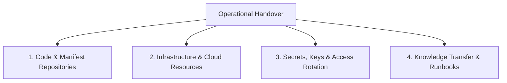

import { Aside, Steps } from '@astrojs/starlight/components';

<Aside type="tip">
Jampuk Intelligence operates on a principal-led, fixed-scope delivery model with zero ongoing retainers or artificial lock-ins. Every engagement culminates in a formal handover ensuring your team has 100% operational ownership of all source code, assets, manifests, and documentation.
</Aside>

## The Four Handover Pillars

---

## 1. Code & Manifest Repositories

- [ ] **Repository Ownership Transfer**: Full administrator transfer of GitHub/GitLab organizations or repositories to client engineering team.
- [ ] **Clean Git History**: All commits signed and verified; zero temporary debug branches or lingering mock commits.
- [ ] **Pinned Dependencies**: All `package.json`, `Dockerfile`, and Helm requirements pinned to deterministic, reproducible releases.
- [ ] **Documentation in Repo**: `README.md`, `ARCHITECTURE.md`, and local developer setup instructions verified on a fresh workstation.

---

## 2. Infrastructure & Cloud Resources

- [ ] **Cloud Account Ownership**: All AWS/GCP/Hetzner accounts and Cloudflare domains belong exclusively to the client; zero billing dependency on Jampuk accounts.
- [ ] **Infrastructure as Code (IaC)**: All Terraform/OpenTofu, CloudFormation, or Ansible playbooks committed and verified with clean plan outputs.
- [ ] **Clean Kubernetes Clusters**: Namespaces, network policies, and Helm releases running without pending pods or crash-looping containers.
- [ ] **Automated Backup Schedules**: Snapshots and cold database dump cron jobs verified and operational.

---

## 3. Secrets, Keys & Access Rotation

- [ ] **Master Secrets Migration**: All environment variables and production secrets migrated into the client's HashiCorp Vault, AWS Secrets Manager, or Kubernetes Secrets.
- [ ] **Jampuk Access Revocation**: Remove all Jampuk engineer SSH keys, IAM users, and API tokens from production perimeters.
- [ ] **Database Master Credentials**: Client generates new administrative passwords and rotates existing service account tokens.
- [ ] **DKIM & TLS Certificates**: Private keys secured inside client-owned keystores.

---

## 4. Runbooks, Observability & Knowledge Transfer

- [ ] **Runbooks Delivered**: Incident playbooks, routine maintenance guides, and DR procedures reviewed with client leads.
- [ ] **Observability Dashboards**: Prometheus/Grafana or Datadog dashboards shared and verified for primary KPIs (traffic, error rate, p95 latency).
- [ ] **Alert Channel Integration**: Slack/PagerDuty notification endpoints routed directly to the client's on-call rotation.
- [ ] **Walkthrough Session**: Dedicated 60–90 minute technical walkthrough recording and architecture Q&A session completed.
- [ ] **Formal Acceptance Sign-Off**: Client technical representative confirms acceptance of all fixed-scope deliverables.

## Further Readings

- [Software Handover Guide](https://www.atlassian.com/software/confluence)
- [Open Source Release Checklist](https://opensource.org/education/releasing-open-source-software)
